  

  

  
  
  
  

 

  

<h3 align="center">· interests ·</h3>

  

<h3 align="center">· currently learning ·</h3>

  

<h3 align="center">· toolbox ·</h3>

  

<h3 align="center">· signal ·</h3>

  
  

  

  

  

  

